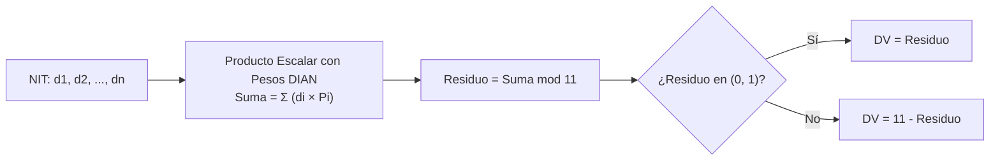

# Validador y Calculador de Dígito de Verificación (DV) NIT DIAN Colombia 🇨🇴

> **Librería ultraligera y CLI en Python para el cálculo y validación del Dígito de Verificación del NIT en Colombia (Módulo 11).**  
> Fielmente implementado según el **Artículo 375 del Estatuto Tributario** y el **Decreto 2460 de 2013 de la DIAN**.

[](https://www.python.org/)
[](tests/test_validator.py)
[](pyproject.toml)
[](LICENSE)

---

## 📌 Tabla de Contenidos
1. [Características Principales](#-características-principales)
2. [Fundamento Legal y Algoritmo Matemático](#-fundamento-legal-y-algoritmo-matemático)
3. [Instalación](#-instalación)
4. [Guía de Uso Rápido (Python API)](#-guía-de-uso-rápido-python-api)
   - [Cálculo del Dígito de Verificación](#1-cálculo-del-dígito-de-verificación-dv)
   - [Validación de NIT Completo](#2-validación-de-nit-completo)
   - [Formateo de NIT con Puntos y Guión](#3-formateo-de-nit)
   - [Integración con Pydantic / FastAPI](#4-ejemplo-de-integración-con-pydantic--fastapi)
5. [Uso desde la Línea de Comandos (CLI)](#-uso-desde-la-línea-de-comandos-cli)
6. [Casos de Prueba Verificados](#-casos-de-prueba-verificados)
7. [Ejercicios y Algoritmos Históricos](#-ejercicios-y-algoritmos-históricos)
8. [Autor](#-autor)

---

## ✨ Características Principales

* ⚡ **Cero Dependencias Externas:** Funciona exclusivamente con la biblioteca estándar de Python sin sobrecargar tu entorno ni generar vulnerabilidades en tu árbol de dependencias.
* 🏢 **Soporte Universal de Longitud:** Compatible con NITs de **1 a 15 dígitos** (personas naturales, cédulas de ciudadanía, personas jurídicas, consorcios y entidades estatales).
* 🧼 **Sanitización Automática:** Acepta enteros (`860007386`), cadenas con puntos (`"860.007.386"`), espacios o formatos con guión (`"860007386-1"`).
* 💻 **Herramienta de Consola (CLI):** Comando interactivo para terminales y scripts bash / pipelines CI/CD.
* 🧪 **Suite de Pruebas Exhaustiva:** Verificado con empresas reales del listado de Grandes Contribuyentes de Colombia.

---

## 📐 Fundamento Legal y Algoritmo Matemático

En Colombia, el Número de Identificación Tributaria (**NIT**) expedido por la **Dirección de Impuestos y Aduanas Nacionales (DIAN)** utiliza un algoritmo ponderado basado en **Módulo 11** para evitar errores de digitación y fraude en transacciones comerciales y facturación electrónica.

### Vector de Pesos Primos Oficial DIAN:
Para un NIT de hasta 15 dígitos, se multiplica cada dígito de derecha a izquierda por los factores de ponderación primos:

$$P = [71, 67, 59, 53, 47, 43, 41, 37, 29, 23, 19, 17, 13, 7, 3]$$

Para el estándar más común de 9 dígitos, se emplean los últimos 9 coeficientes: `[41, 37, 29, 23, 19, 17, 13, 7, 3]`.



---

## 📦 Instalación

Puedes instalar la librería directamente desde GitHub usando `pip`:

```bash
pip install git+https://github.com/KevinAndrey96/dian-nit-validator-python.git
```

O clonar el repositorio localmente para desarrollo:

```bash
git clone https://github.com/KevinAndrey96/dian-nit-validator-python.git
cd dian-nit-validator-python
pip install -e .
```

---

## 🚀 Guía de Uso Rápido (Python API)

### 1. Cálculo del Dígito de Verificación (DV)
Calcula el dígito que debe acompañar a cualquier NIT:

```python
from nit_validator import calcular_dv

# Entrada como cadena o entero
dv_bancolombia = calcular_dv("860007386")
print(dv_bancolombia)  # 1

# Soporta NITs con formato de puntos
dv_ecopetrol = calcular_dv("899.999.068")
print(dv_ecopetrol)    # 1
```

### 2. Validación de NIT Completo
Valida si el dígito proporcionado coincide con el cálculo matemático oficial:

```python
from nit_validator import validar_nit

# Formato cadena unificada con guión:
print(validar_nit("860007386-1"))       # True
print(validar_nit("860.007.386-1"))     # True
print(validar_nit("860007386-9"))       # False (DV incorrecto)

# Formato separado (NIT, DV):
print(validar_nit(860007386, 1))        # True
print(validar_nit("860007386", "1"))    # True
```

### 3. Formateo de NIT
Convierte números crudos a la representación estándar colombiana:

```python
from nit_validator import formatear_nit

print(formatear_nit(860007386))                  # "860.007.386-1"
print(formatear_nit(860007386, incluir_dv=False)) # "860.007.386"
```

### 4. Ejemplo de Integración con Pydantic / FastAPI

Ideal para microservicios de facturación electrónica y pasarelas de pago:

```python
from pydantic import BaseModel, validator
from nit_validator import validar_nit, formatear_nit

class EmpresaSchema(BaseModel):
    razon_social: str
    nit: str

    @validator('nit')
    def validar_nit_dian(cls, v):
        if not validar_nit(v):
            raise ValueError('El NIT proporcionado o su dígito de verificación no son válidos ante la DIAN')
        return formatear_nit(v)
```

---

## 🖥️ Uso desde la Línea de Comandos (CLI)

El paquete incluye una CLI que puedes invocar directamente:

```bash
# Calcular el DV de un NIT:
python3 -m nit_validator 860007386
# Salida:
# Dígito de Verificación (DV): 1
# NIT Completo: 860.007.386-1

# Validar un NIT (retorna código de salida 0 si es válido, 1 si es inválido):
python3 -m nit_validator 860007386-1
# Salida:
# ✅ VÁLIDO: El NIT 860007386-1 coincide con el algoritmo oficial DIAN.

# Formatear con separadores de miles y guión:
python3 -m nit_validator -f 890900050
# Salida:
# 890.900.050-1
```

---

## 🏢 Casos de Prueba Verificados

El algoritmo ha sido probado contra registros reales de la DIAN:

| Entidad / Gran Contribuyente | NIT Base | Dígito (DV) | NIT Completo | Estado |
| :--- | :---: | :---: | :---: | :---: |
| **Bancolombia S.A.** | `860007386` | **1** | `860.007.386-1` | ✅ Válido |
| **Ecopetrol S.A.** | `899999068` | **1** | `899.999.068-1` | ✅ Válido |
| **Grupo Nutresa S.A.** | `890900050` | **1** | `890.900.050-1` | ✅ Válido |
| **Almacenes Éxito S.A.** | `890900608` | **9** | `890.900.608-9` | ✅ Válido |
| **DIAN** | `800197268` | **4** | `800.197.268-4` | ✅ Válido |

---

## 🗃️ Ejercicios y Algoritmos Históricos

Este repositorio conserva su antigüedad histórica de commits. Los ejercicios complementarios desarrollados previamente se preservan organizados en el directorio `extra_algorithms/`:
* `extra_algorithms/robot_fsm.py`: Simulación de orientación 2D mediante Máquina de Estados Finitos (FSM).
* `extra_algorithms/student_ranking.py`: Agregación y ordenamiento multivariable de estructuras de datos.

---

## 🧪 Ejecución de Pruebas Unitarias

Para ejecutar la suite de pruebas del proyecto:

```bash
python3 -m unittest discover -s tests -v
```

---

## 👨‍💻 Autor

**Kevin Andrey Herrera Silva**  
*Senior Backend Engineer & Software Architect*  
* GitHub: [@KevinAndrey96](https://github.com/KevinAndrey96)  
* Email: kahs_kevin@hotmail.com
