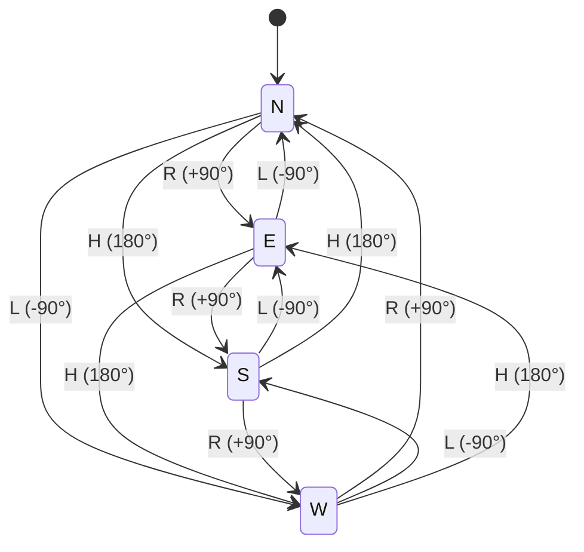

# Python Algorithmic Solutions & Financial Utilities 🐍

> **Colección de algoritmos prácticos y utilidades en Python:** Cálculo y validación del Dígito de Verificación NIT DIAN (Módulo 11), Máquina de Estados Finitos para Navegación 2D y Agregación de Estructuras de Datos.

[](https://www.python.org/)
[](test_exercises.py)
[](LICENSE)

---

## 📌 Tabla de Contenidos
1. [Descripción de los Algoritmos](#-descripción-de-los-algoritmos)
   - [1. Validador de NIT DIAN Colombia (Módulo 11)](#1-validador-de-nit-dian-colombia-módulo-11)
   - [2. Máquina de Estados Cardinal para Navegación 2D](#2-máquina-de-estados-cardinal-para-navegación-2d)
   - [3. Agregación y Ordenamiento Multivariable](#3-agregación-y-ordenamiento-multivariable)
2. [Suite de Pruebas Unitarias](#-suite-de-pruebas-unitarias)
3. [Instalación y Ejecución](#-instalación-y-ejecución)
4. [Autor](#-autor)

---

## 📖 Descripción de los Algoritmos

### 1. Validador de NIT DIAN Colombia (Módulo 11)
*Archivo:* `verification.py`

En Colombia, el Número de Identificación Tributaria (**NIT**) expedido por la Dirección de Impuestos y Aduanas Nacionales (**DIAN**) utiliza un algoritmo ponderado basado en **Módulo 11** para verificar la autenticidad e integridad del número tributario (Artículo 375 del Estatuto Tributario).

#### Fundamento Matemático:
Dada una serie de dígitos del NIT $d_1, d_2, \dots, d_n$ alineados de derecha a izquierda, se multiplican por una serie de factores primos fijos:
$$P = [41, 37, 29, 23, 19, 17, 13, 7, 3]$$

1. Se calcula la suma ponderada:
   $$\text{Suma} = \sum_{i=0}^{8} (d_i \times P_i)$$
2. Se obtiene el residuo de la división entera por 11:
   $$\text{Residuo} = \text{Suma} \pmod{11}$$
3. Reglas de validación:
   * Si $\text{Residuo} \in \{0, 1\}$, el dígito de verificación es el propio residuo.
   * Si $\text{Residuo} \ge 2$, el dígito de verificación es $11 - \text{Residuo}$.

```python
from verification import verificar_nit

# Ejemplo: Bancolombia S.A. (NIT: 860007386 - DV: 1)
is_valid = verificar_nit(860007386, 1)
print(is_valid)  # True
```

---

### 2. Máquina de Estados Cardinal para Navegación 2D
*Archivo:* `robot.py`

Modela una **Máquina de Estados Finitos Determinista (FSM)** que simula la orientación espacial de un agente autónomo sobre un plano bidimensional.

#### Transiciones de Estado:
* **Estados posibles:** $\{N, E, S, W\}$ (Norte, Este, Sur, Oeste).
* **Entradas (Acciones de giro):**
  * `R` (*Right*): Giro horario de 90°
  * `L` (*Left*): Giro antihorario de 90°
  * `H` (*Half-turn*): Giro de 180°
  * `.` (*Neutral*): Mantiene orientación actual



Permite encadenar secuencias de movimientos continuos:
```python
from robot import movimiento_robot

# Si inicia en Norte, gira a la Derecha (E), luego media vuelta (W) y mantiene:
resultado = movimiento_robot('N', 'R', 'H', '.')
print(resultado)  # 'W' (West / Oeste)
```

---

### 3. Agregación y Ordenamiento Multivariable
*Archivo:* `student.py`

Procesa y analiza colecciones heterogéneas de diccionarios en memoria. Resuelve la identificación del elemento con valor máximo en múltiples dimensiones (materias académicas), empleando funciones de orden superior (`sorted` con clave `lambda`) para garantizar determinismo en el desempate por orden alfabético.

---

## 🧪 Suite de Pruebas Unitarias

El proyecto incluye pruebas automatizadas con el framework nativo `unittest`, verificando casos de borde y respuestas esperadas sin requerir dependencias externas:

```bash
python3 -m unittest test_exercises.py -v
```

Resultado de ejecución:
```text
test_robot_rotations (test_exercises.TestExercises) ... ok
test_robot_sequence (test_exercises.TestExercises) ... ok
test_student_grading (test_exercises.TestExercises) ... ok
test_verificar_nit_invalid (test_exercises.TestExercises) ... ok
test_verificar_nit_valid (test_exercises.TestExercises) ... ok

----------------------------------------------------------------------
Ran 5 tests in 0.001s

OK
```

---

## 💻 Instalación y Ejecución

1. **Clonar repositorio:**
   ```bash
   git clone https://github.com/KevinAndrey96/basic-exercises-using-python.git
   cd basic-exercises-using-python
   ```

2. **Ejecutar pruebas:**
   ```bash
   python3 -m unittest discover
   ```

3. **Ejecutar script individual:**
   ```bash
   python3 verification.py
   ```

---

## 👨‍💻 Autor

**Kevin Andrey Herrera Silva**  
*Senior Backend Engineer & Software Architect*  
* GitHub: [@KevinAndrey96](https://github.com/KevinAndrey96)  
* Email: kahs_kevin@hotmail.com
